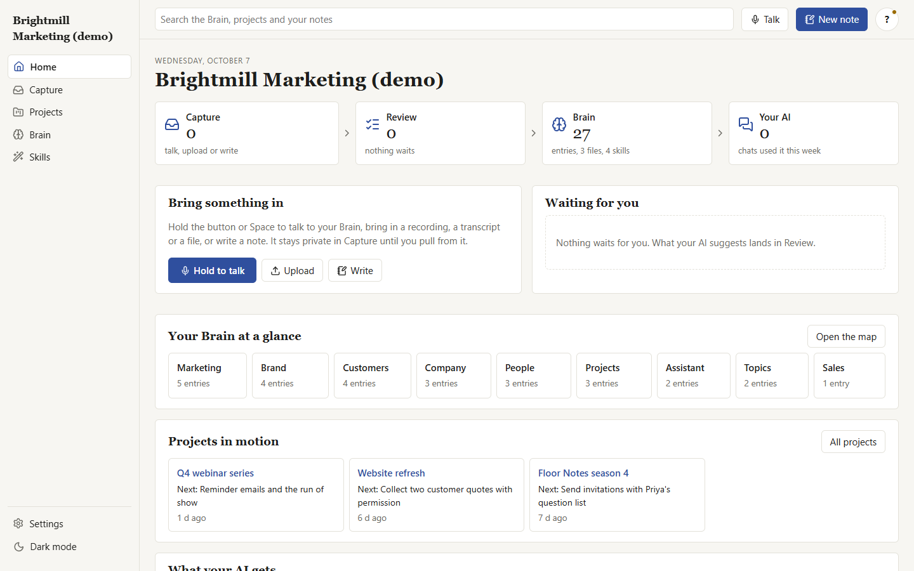
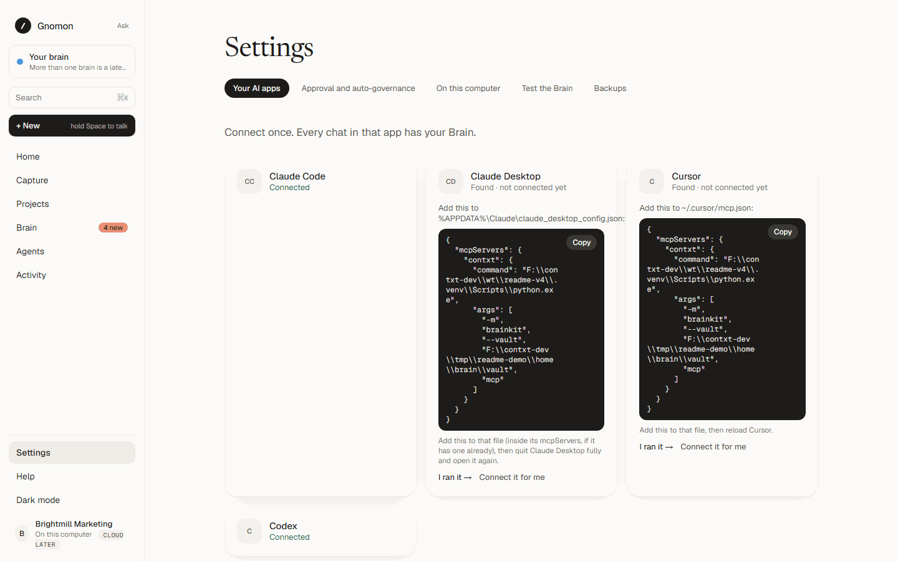
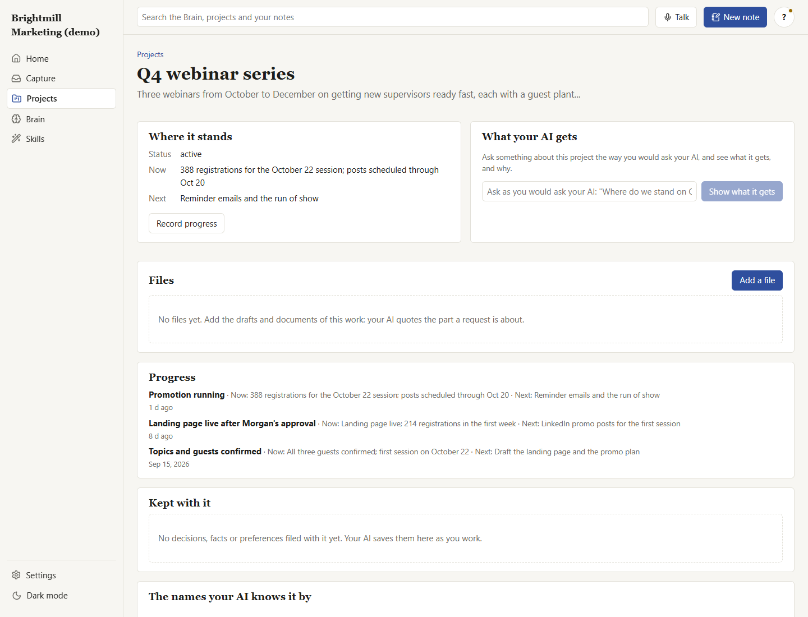
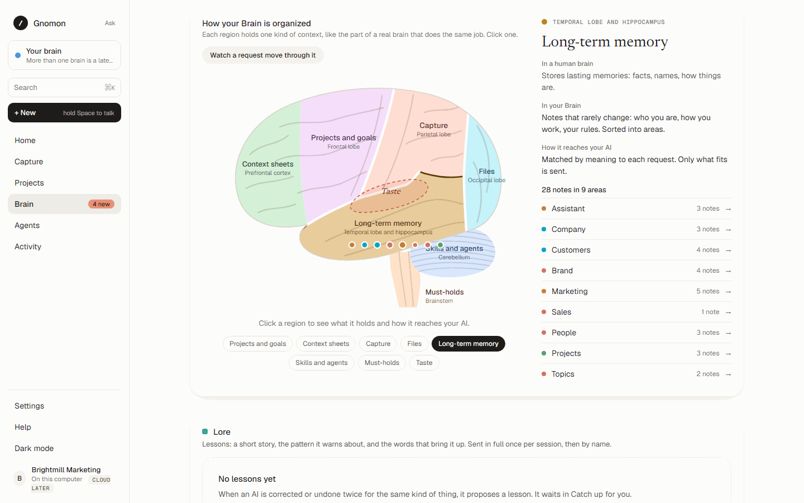
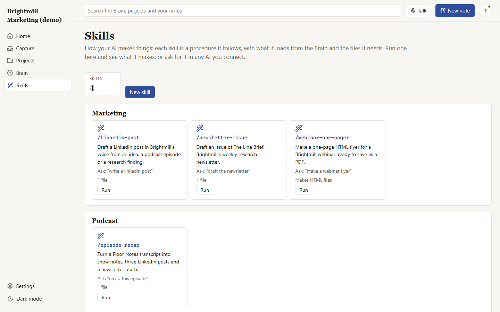

# Contxt

**One Brain for every AI you use. On your computer, governed by you.**

You tell each AI the same things over and over: who you are, how you want work done, what
you are working on, where each project stands. Contxt keeps all of that in one Brain on your
own computer, and every AI app you connect (Claude Code, Claude Desktop, Codex, Cursor, any
MCP client) reads the part each request needs and saves what it learns, for your approval.



> Pre-release. Source-available under the [PolyForm Shield License 1.0.0](LICENSE): use it and
> change it freely, but not to compete with it. See [LICENSING.md](LICENSING.md).

## How it works

```
 your work                    your Brain                       every AI app you use
 ---------                    ----------                       --------------------
 what you say, files,   ->    plain Markdown files, in   ->    asks for the context a request
 decisions, progress          folders, every change in         needs, and proposes what it
                              git, on your computer            learns: you approve
```

- **Your Brain is files you own.** Notes, rules, skills, projects and documents are Markdown
  in a folder, with every change kept in git. Any editor can open them; nothing is locked
  in an app or a cloud.
- **Every AI gets the right part.** Each request gets a small, focused packet: the rules that
  always apply, the notes and file sections that request is about, and where the project it
  names stands. Never the whole Brain.
- **Nothing changes without you.** Your own words and files go in at once with an undo point.
  What an AI picks up waits for you in Catch up, a few minutes a week; a preset (Personal,
  Careful, Regulated) says what waits.
- **Local by default.** The app runs on `127.0.0.1`. Matching by meaning and speech to text
  run on local models. Nothing leaves your computer except what your AI app sends to its own
  model.

## Quick start

You need [git](https://git-scm.com/) and [uv](https://docs.astral.sh/uv/), which brings its
own Python. To install uv:

- macOS and Linux: `curl -LsSf https://astral.sh/uv/install.sh | sh`
- Windows (PowerShell): `powershell -ExecutionPolicy ByPass -c "irm https://astral.sh/uv/install.ps1 | iex"`

Then, in a terminal:

```bash
git clone https://github.com/rami-guzlan/Contxt.git
cd Contxt
uv sync
uv run contxt web --download
uv run contxt setup
uv run contxt check
uv run contxt serve
```

- `web --download` fetches this version's built web app and checks it. Building it yourself
  instead takes [Node.js](https://nodejs.org/) 20.19+: `npm install`, then `npm run build`.
- `setup` makes your Brain (from the empty starter) and the folders beside it.
- `check` confirms everything works, and says what to fix when something does not.
- `serve` starts the app on `http://127.0.0.1:8787` and prints your sign-in link.

Then connect your AI:

```bash
uv run contxt connect claude-code
```

prints one command. Run it once, and every Claude Code session has your Brain. The same works
for `claude-desktop`, `codex`, `cursor` and `other`, and the app shows it under **Settings, AI
apps**. Each also prints one line to add to that app's own instructions (for Claude Code,
`~/.claude/CLAUDE.md`), so its model asks the Brain before every answer:



The full walkthrough, with Docker and what to do when something goes wrong, is in
[docs/setup.md](docs/setup.md).

## Try a demo Brain

```bash
uv run contxt demo knowledge-company
```

Each demo runs from its own folder on its own port, so your Brain is never touched.

| Demo | Who it is for |
| --- | --- |
| `knowledge-company` | Brightmill, a made-up knowledge company, as its one-person marketing team runs it: voice and approval rules, audience research, a webinar series, a podcast, content skills |
| `programmer` | Kai, a made-up backend engineer: machine and stack, code style and git rules, services and deploys, an open source release |
| `entrepreneur` | Riley, a made-up founder: a seed-stage startup and its numbers, a seed round, a past company's lessons, angel checks |
| `personal` | Taylor, a made-up parent: family schedules and an allergy, the house, the budget, training, a trip to Japan |

Everything in the demos is invented. To start your own Brain from one,
`uv run contxt setup --brain programmer`. See [brains/README.md](brains/README.md).

## Where your things live

| Folder | What it holds | In this repository? |
| --- | --- | --- |
| `brain/` | Your Brain: notes, skills, references, projects, as Markdown | No: a git repository of its own, which you can push to a private remote for backup |
| `data/` | The app's database, uploaded files, your sign-in key, backups | No |
| `outputs/` | What your AI makes through the app | No |
| `.env` | This folder's settings | No |

The Brain is files, and the app's bookkeeping is a small SQLite database, on purpose: files
are what every AI tool and editor can read, with a history you can undo, while the app's live
state (recordings waiting for a summary, AI work in progress, sign-in keys) needs a database
that stays consistent when several things change at once. What is worth keeping moves from
the app into the Brain when you approve it.

## The app

| Page | What it is for |
| --- | --- |
| Home | How you are doing in one line, what the Brain is for, what your AIs asked, what came in, projects in motion, your AI apps, ask your Brain, see the difference |
| Catch up | What needs your yes, as a plan with a time: decisions one at a time with a recommendation, groups kept with one tap, a little upkeep each week |
| Capture | Talk (hold Space), record, upload or write: each gets a summary, and the Brain pulls out what serves your goals and projects |
| Projects | Each project's brief, where it stands, its progress and files, what your AI asked about it |
| Brain | What your AI knows, in the words it receives; every note; its files; the questions it could not answer |
| Skills | Procedures your AI follows, including the ones every Brain comes with: run one here, or ask for it in any AI |
| Outputs | What your AI made, organized and downloadable, each file with what it was made from |
| Activity | Every request from every AI app: what it got and why; every change, with its undo point |
| Settings | Your AI apps, your goals, approval, local models and the app's own AI work, backups |







## Local models

`contxt setup` fetches, once, a small embedding model (about 70 MB) so your Brain matches
requests by meaning, on your computer (`--offline` skips it, and the Brain matches by words).

```bash
uv run contxt models --download
```

adds, once, a speech model (about 480 MB) so talk and recordings become text on your
computer. Without it, talking is off.

## Repository

```
apps/server          the app's API, its MCP endpoint, the worker and the contxt command
apps/web             the web app
packages/core        application services behind one facade
packages/brain       the Brain engine: routing, governance, files, its MCP server
packages/connectors  how each AI app connects
brains/              starter Brains: empty and four demos
docs/                setup, architecture, MCP, operations, decisions, the Brain's design
```

For AI coding agents working in this repository: [AGENTS.md](AGENTS.md).

## Documentation

- [Setup](docs/setup.md): install, your Brain, connecting your AI apps, Docker
- [Architecture](docs/architecture.md) and [decisions](docs/adr/)
- [MCP](docs/mcp.md): the Brain's server and the app's endpoint
- [Running the app's AI work](docs/runners.md)
- [Operations](docs/operations.md): backups, upgrades, the private-server profile
- [The Brain](docs/brain/ARCHITECTURE.md): routing, governance, capture, configuration

## Development

```bash
uv run pytest
uv run ruff check .
uv run mypy
npm test
npm run typecheck
```

See [CONTRIBUTING.md](CONTRIBUTING.md). Security reports: [SECURITY.md](SECURITY.md).

## License

Copyright 2026 Rami Guzlan. Source-available under the
[PolyForm Shield License 1.0.0](LICENSE): you may use, change and share Contxt for any purpose
except competing with it. [LICENSING.md](LICENSING.md) says what that means in plain words.
